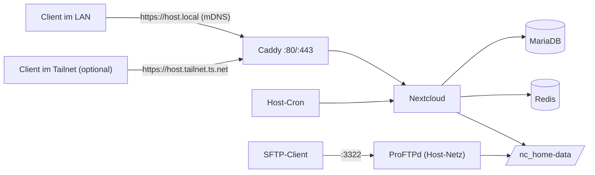

# Nextcloud + ProFTPd hinter Caddy – erreichbar per mDNS, optional über Tailscale

Schritt-für-Schritt-Anleitung und fertige Dateien für einen kleinen Heim- oder Büroserver mit Docker Compose.

- **Nextcloud** (offizielles Apache-Image) mit **MariaDB** und **Redis**
- **Caddy** als Reverse Proxy
  - für `<hostname>.local` per mDNS (Avahi) im LAN – Zertifikat der internen Caddy-CA
  - *optional, falls externe Erreichbarkeit erwünscht:* `<hostname>.<tailnet>.ts.net` über **Tailscale** – gültiges Zertifikat
- **ProFTPd** als SFTP-Server (Port 3322) mit direktem Zugriff auf das Nextcloud-Datenverzeichnis, FTPS optional
- Nextcloud-Hintergrundjobs per **Cron auf dem Host**

Alle Zugriffe laufen über Namen – ob der Server seine IP per DHCP bekommt oder eine feste hat, spielt keine Rolle.



## Ports

| Port | Dienst | Benötigt |
|---|---|---|
| 22/tcp | SSH | ja |
| 5353/udp | mDNS (Avahi) | ja |
| 80/tcp, 443/tcp, 443/udp | Caddy | ja |
| 3322/tcp | SFTP (ProFTPd) | ja |
| 2121/tcp | FTPS, Steuerverbindung | optional |
| 50000–50020/tcp | FTPS, passive Datenverbindungen | optional |

## Anleitung

| Kapitel | Inhalt |
|---|---|
| [1. Host vorbereiten](docs/01-host-vorbereitung.md) | Ubuntu, Hostname, SSH, Firewall |
| [2. Avahi / mDNS](docs/02-avahi-mdns.md) | Erreichbarkeit als `<hostname>.local` |
| [3. Tailscale *(optional)*](docs/03-tailscale.md) | Erreichbarkeit von außerhalb, HTTPS-Zertifikat |
| [4. Admin-Benutzer](docs/04-admin-benutzer.md) | sudo, Anmeldung per SSH-Key |
| [5. Docker](docs/05-docker.md) | Docker Engine + Compose-Plugin |
| [6. Projektdateien](docs/06-projektdateien.md) | `.env`, `docker-compose.yml`, Caddyfile, ProFTPd, Besitzrechte |
| [7. Erster Start](docs/07-erster-start.md) | Container starten – zunächst ohne ProFTPd |
| [8. Caddy-Root-CA](docs/08-caddy-root-ca.md) | Zertifikat für `.local` auf den Clients importieren |
| [9. Installation im Browser](docs/09-installation-browser.md) | Admin-Konto anlegen |
| [10. Nachkonfiguration](docs/10-nachkonfiguration.md) | ENV vs. nachträglich, Post-Install-Skript, Cron |
| [11. ProFTPd](docs/11-proftpd.md) | Benutzer anlegen, SFTP, optional FTPS |
| [12. Betrieb](docs/12-betrieb.md) | Backup, Logs, Fehlersuche |

## Dateien in diesem Repository

```
.
├── .env.example                     # Vorlage für .env
├── docker-compose.yml
├── caddy/
│   ├── Caddyfile                    # Variante A: mit Tailscale
│   └── Caddyfile.ohne-tailscale     # Variante B: nur LAN
├── proftpd/config/
│   ├── proftpd.conf
│   ├── passwd                       # nur www-data – FTP-Benutzer siehe Kapitel 11
│   ├── group
│   └── shadow
├── scripts/
│   └── post-install.sh              # Einstellungen, die es nicht per ENV gibt
└── docs/                            # die Anleitung
```

> **Hinweis:** Auf dem Server werden in `proftpd/config/passwd` und `shadow` später echte Benutzer und Passwort-Hashes eingetragen. Diese Änderungen nicht zurück in ein öffentliches Repository pushen.
